# BlazorTailwindUI

<p align="center">
  
</p>

<p align="center">
  <strong>A modern, mobile-first component library and Adaptive Generative UI (AGUI) engine for Blazor WebAssembly and Tailwind CSS.</strong>
</p>

<p align="center">
  <a href="https://dotnet.microsoft.com/"></a>
  <a href="https://tailwindcss.com/"></a>
  <a href="CHANGELOG.md"></a>
  <a href="docs/COMPONENT_CATALOG.md"></a>
  <a href="LICENSE"></a>
</p>

<p align="center">
  <a href="#-quick-start">Quick Start</a> •
  <a href="#-component-examples">Examples</a> •
  <a href="#-component-catalog-234-components">Component Catalog</a> •
  <a href="docs/COMPONENT_CATALOG.md">Full API Docs</a> •
  <a href="wwwroot/videos/hyperframes_masterclass.html">1080p Video Tour</a>
</p>

---

## ⚡ Features

- **234 Native Components** — Built with C# and Tailwind CSS v3.4+. Pure WebAssembly, zero third-party commercial UI dependencies.
- **Mobile-First by Default** — 44px touch targets, bottom sheets, swipe gestures, and responsive DataGrid mobile cards.
- **Adaptive Generative UI (AGUI)** — Runtime prompt-to-UI synthesis with dual-plane tool calling (Frontend WASM + Backend API).
- **Agent Ops (human-in-the-loop)** — A transport-agnostic agent session with approval gates that genuinely block high-risk tool calls, takeover and hand-back, an editable shared-state inspector and an exportable audit trail. See [Agent Ops](#-agent-ops-approvals-takeover--audit).
- **Live AG-UI over SSE + Agent Kit** — `SseAgentTransport` talks to a real AG-UI agent over server-sent events and reports approval decisions back so the server waits at the gate. Plus 26 new components, several modelled on patterns in CopilotKit and OpenBot (see the credits) (thread list, A2UI generative UI, sandboxed MCP apps, voice, live screen, handoff, grants, memory, routines) and new core inputs (calendar, time picker, radio group, text area). See [Agent Kit](#-agent-kit-copilotkit--openbot-components).
- **Accessible by Default** — High-contrast mode (toggle or OS `prefers-contrast`), `forced-colors` support, reduced motion, RTL-safe layout, and axe-core WCAG 2.x A/AA checks in the browser tests.
- **Zero-FOUC Theme Engine** — Instant dark mode and 12 curated color presets (Indigo, Emerald, Violet, Rose, Cyan, Amber, etc.) with custom hex palette generation.
- **Enterprise Flagships** — CRM Draggable Dashboard (`GridStack`), Flattened PDF Contract Signer with SHA-256 sealing, C# 15 Discriminated Union boundary, 100% offline Tesseract WebAssembly OCR (`wwwroot/lib/tesseract/`), 150+ NACHA Bank Routing resolver, and ChoETL.NACHA 94-character fixed-width ACH exporter.

---

## 🚀 Quick Start

### 1. Register Services
Add BlazorTailwindUI services in `Program.cs`:

```csharp
builder.Services.AddBlazorTailwindUI();
```

### 2. Include Assets
Add the stylesheet and scripts to `wwwroot/index.html`:

```html
<link rel="stylesheet" href="css/app.min.css" />
<script src="js/theme.js"></script>
<script src="js/kanban.js"></script>
```

### 3. Import Namespaces
Add to your `_Imports.razor`:

```razor
@using BlazorTailwindUI.Components.UI
@using BlazorTailwindUI.Models
```

---

## 💡 Component Examples

### Buttons & Badges
```razor
<TwButton Variant="ButtonVariant.Primary" Size="ComponentSize.Md" OnClick="HandleSubmit">
    Submit Request
</TwButton>

<TwBadge Variant="SemanticVariant.Success" Size="ComponentSize.Sm" ShowDot="true">
    Active
</TwBadge>
```

### Responsive DataGrid
```razor
<TwDataGrid TItem="UserRecord" Items="@Users" Selectable="true" PageSize="10">
    <Columns>
        <TwDataGridColumn TItem="UserRecord" Title="Name" Property="u => u.Name" SortBy="u => u.Name" />
        <TwDataGridColumn TItem="UserRecord" Title="Role" Property="u => u.Role" />
        <TwDataGridColumn TItem="UserRecord" Title="Status">
            <CellTemplate Context="user">
                <TwBadge Variant="@(user.IsActive ? SemanticVariant.Success : SemanticVariant.Default)" ShowDot="true">
                    @(user.IsActive ? "Active" : "Offline")
                </TwBadge>
            </CellTemplate>
        </TwDataGridColumn>
    </Columns>
</TwDataGrid>
```

### Responsive Modal & Bottom Sheet
```razor
<TwButton OnClick="() => _isOpen = true">Open Dialog</TwButton>

<TwModal @bind-IsOpen="_isOpen" Title="Confirm Action" Description="Desktop centered dialog, mobile bottom sheet.">
    <p class="text-sm text-slate-600 dark:text-slate-400">Are you sure you want to proceed?</p>
    <FooterContent>
        <TwButton Variant="ButtonVariant.Ghost" OnClick="() => _isOpen = false">Cancel</TwButton>
        <TwButton Variant="ButtonVariant.Primary" OnClick="Save">Confirm</TwButton>
    </FooterContent>
</TwModal>
```

### Modern Progress & Activity Rings
```razor
<!-- Apple Fitness style concentric activity rings -->
<TwModernProgress Type="TwModernProgress.ProgressType.ConcentricMultiRing"
                  Value="85" SecondaryValue="68" TertiaryValue="94" />

<!-- Speedometer dashboard arc gauge -->
<TwModernProgress Type="TwModernProgress.ProgressType.SpeedometerArc"
                  Value="84" Label="Velocity" />
```

### Check 21 MICR & Local Tesseract OCR
```razor
<TwMicrCheckReader OnCheckScanned="HandleScanned"
                   OnDepositApproved="HandleApproved"
                   OnNachaExported="HandleNachaExport"
                   OnJsonExported="HandleJsonExport" />
```

---

## 🛡️ Agent Ops: Approvals, Takeover & Audit

Drop in a complete human-in-the-loop agent workspace:

```razor
<TwAgentConsole />
```

<p align="center">
  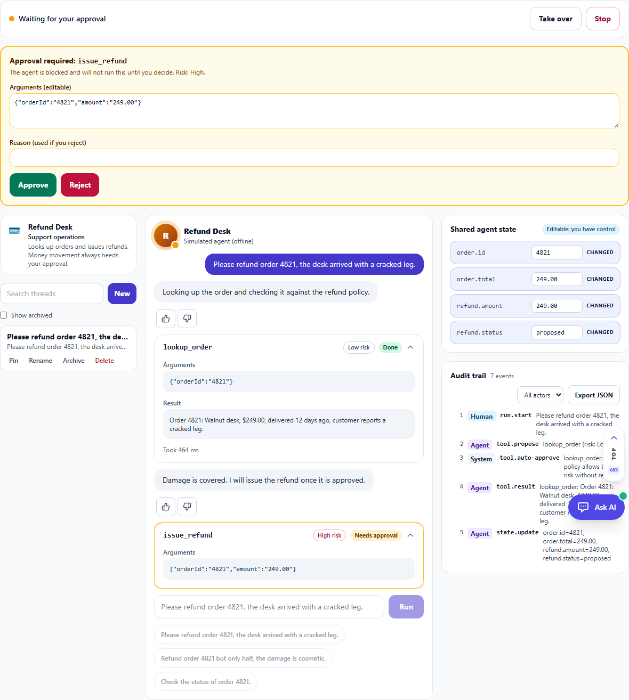
</p>

What it does (all of it is real behavior, exercised by unit and browser tests):

- **Approval gates block.** A tool call marked as requiring approval is held until a human approves (optionally with edited, validated JSON arguments) or rejects with a reason. A rejection reroutes the agent; it is not a notification.
- **Takeover pauses the agent.** The agent stops before its next step; the human edits shared state, and the edit changes what the agent does next. Hand back resumes it.
- **Everything is audited.** Human, agent and system events are recorded in order and can be exported as JSON.

| Approval gate | Rejected, agent escalated | Takeover |
| :---: | :---: | :---: |
|  | 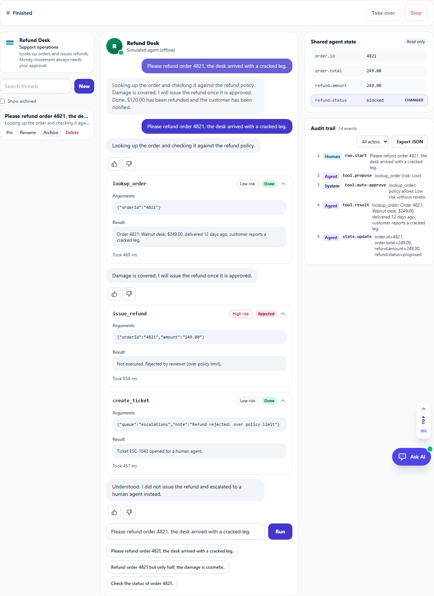 | 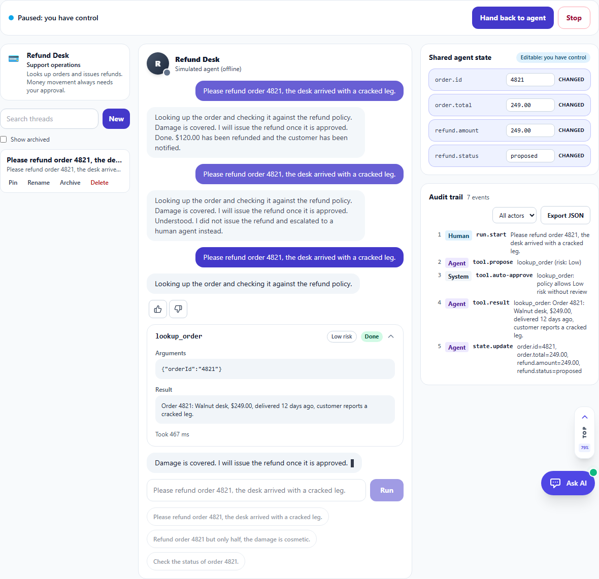 |

### Drive your own agent

The console runs on `AgentRunSession`, which consumes an `IAgentTransport`, an `IAsyncEnumerable<AgUiEvent>` modelled on the [AG-UI](https://github.com/ag-ui-protocol/ag-ui) event stream (text deltas, tool call start/args/end/result, state deltas). The session pulls events lazily, so anything your transport does between two yields is held back while the run is paused or awaiting approval.

```csharp
public sealed class MyAgentTransport : IAgentTransport
{
    public async IAsyncEnumerable<AgUiEvent> RunAsync(string prompt, AgentRunContext context,
        [EnumeratorCancellation] CancellationToken ct)
    {
        yield return new AgUiEvent(AgUiEventType.ToolCallStart, "call_1", "issue_refund",
            Risk: ToolRisk.High, RequiresApproval: true);
        yield return new AgUiEvent(AgUiEventType.ToolCallArgs, "call_1", Text: "{\"amount\":\"249.00\"}");
        yield return new AgUiEvent(AgUiEventType.ToolCallEnd, "call_1");

        // The session has already waited for the human; read the decision.
        if (context.DecisionFor("call_1") is { Approved: true } decision)
            yield return new AgUiEvent(AgUiEventType.ToolCallResult, "call_1", Text: "Refund issued.");
    }
}

builder.Services.AddScoped<IAgentTransport, MyAgentTransport>(); // before AddBlazorTailwindUI()
builder.Services.AddBlazorTailwindUI();
```

Compose the pieces yourself with `TwApprovalGate`, `TwToolCallCard`, `TwTakeoverBar`, `TwAgentStateInspector`, `TwAuditTrail` and `TwAgentRoster`, each taking the same `AgentRunSession`. The default transport is an offline simulated refund-desk agent, so the demo runs with no backend.

---

## 🧰 Agent Kit: generative UI, voice, threads and the agent control plane

### Live AG-UI over server-sent events

```csharp
builder.Services.AddScoped<IAgentTransport>(sp => new SseAgentTransport(
    sp.GetRequiredService<HttpClient>(),
    new SseAgentTransportOptions { RunUrl = "https://agent.example.com/agui/run", DecisionUrl = "https://agent.example.com/agui/decision" }));
```

`SseAgentTransport` POSTs the prompt and shared state, parses the `text/event-stream` (`RUN_STARTED`, `TEXT_MESSAGE_CONTENT`, `TOOL_CALL_START/ARGS/END/RESULT`, `STATE_SNAPSHOT`, `STATE_DELTA`, `RUN_FINISHED`, `RUN_ERROR`) and, when a tool call is gated, **posts the human's decision (with any edited arguments) to `DecisionUrl`**, so the server holds the run until you decide. A tool call can declare `"risk"` and `"requiresApproval"` to engage the gate. The Agent Ops tab has a *Live AG-UI endpoint* switch; `tests/e2e/agui_server.py` is a small reference agent you can run against it.

| Threads, suggestions, feedback | Live agent held at the gate |
| :---: | :---: |
| 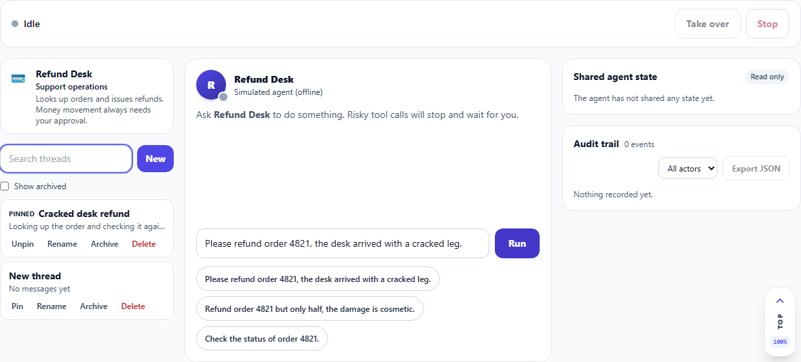 | 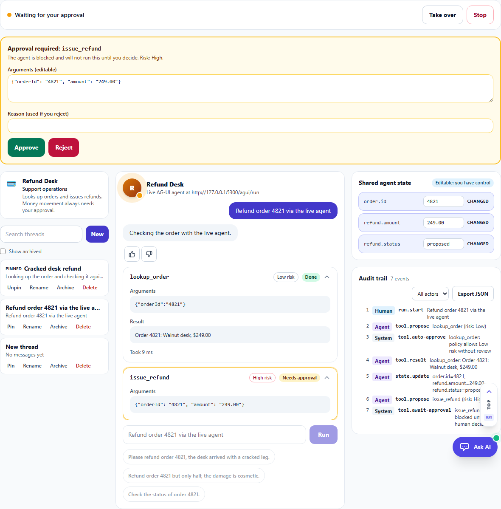 |

### New components

| Area | Components | What they do |
| --- | --- | --- |
| **Threads** | `TwThreadList` | Conversation threads: search, new, rename, pin, archive, delete; persisted to `localStorage` and wired into `TwAgentConsole` (`ShowThreads`). |
| **Generative UI** | `TwA2uiSurface` | Renders an interface the agent describes as JSON (A2UI v0.9): Text, Column, Row, Card, Button, TextField, CheckBox, ChoicePicker, Slider, Tabs, Image, Icon, Divider; two-way data binding; button actions return their resolved context. |
| | `TwMcpAppFrame` | MCP app host in a sandboxed iframe with an opaque origin (never `allow-same-origin`), a locked-down CSP with validated extra domains, and a `postMessage` bridge. |
| **Voice and chat** | `TwVoiceInput`, `TwLiveWaveform` | Push-to-talk microphone with a live level meter and optional speech-to-text hook. |
| | `TwChatSuggestions`, `TwFeedbackButtons`, `TwAttachmentQueue`, `TwMessageScroller` | Suggested prompts, thumbs up/down with reason, validated file staging, and a transcript that follows new content with Jump to latest. |
| **Agent control plane** | `TwHandoffPanel`, `TwLiveScreen` | A stuck agent asks you to take the wheel; its screen with pointer and click reporting while you drive. |
| | `TwDryRunChanges`, `TwActivityLog`, `TwCommandOutput`, `TwRedactedValue` | What an action would change, what the agent did, terminal output, and credential masking (`RedactionService`, ported rules). |
| | `TwGrantList`, `TwMemoryList`, `TwRoutinesList`, `TwQuestionnaire`, `TwAgentOrb` | Tool access levels with revoke, searchable memory, scheduled routines, structured agent questions, and a state-aware avatar. |
| **Core inputs** | `TwCalendar`, `TwTimePicker`, `TwRadioGroup<T>`, `TwTextArea`, `TwButtonGroup`, `TwSpinner` | Keyboard-first date grid (ARIA pattern), 12/24-hour picker, generic radios, counter and auto-grow, joined buttons, and a reduced-motion-aware spinner. |

### Credits and references

These are our own C# implementations. Where an idea or a small piece of logic comes from an open-source project, it is credited here and in the source comments (both projects are MIT licensed; notices in [`THIRD_PARTY_NOTICES.md`](THIRD_PARTY_NOTICES.md)).

| Component or service | Relationship |
| --- | --- |
| `TwThreadList`, `AgentThreadStore` | Our own design. |
| `SseAgentTransport`, `AgUiWireMapper`, `SseParser` | Our own implementation of the [AG-UI](https://github.com/ag-ui-protocol/ag-ui) event stream. The approval-decision endpoint is our own extension, not part of AG-UI. |
| `TwA2uiSurface`, `A2uiSurface` | Our own implementation of the A2UI v0.9 message model. [CopilotKit's `a2ui-renderer`](https://github.com/CopilotKit/CopilotKit/tree/main/packages/a2ui-renderer) is the React counterpart. |
| `TwMcpAppFrame` | Our own implementation of the MCP Apps sandbox model. The sandbox flags and the CSP host-source pattern are **adapted** from CopilotKit's `mcp-apps-renderer`. |
| `RedactionService`, `TwRedactedValue` | Credential-key rules **adapted** from CopilotKit's `learning` package redaction. |
| `TwChatSuggestions`, `TwFeedbackButtons`, `TwAttachmentQueue` | Modelled on the matching pieces of CopilotKit's `react-ui` chat components. |
| `TwVoiceInput` | Our own. CopilotKit's `voice` package only provides server-side transcription. |
| `TwHandoffPanel`, `TwLiveScreen`, `TwDryRunChanges`, `TwActivityLog`, `TwCommandOutput`, `TwGrantList`, `TwMemoryList`, `TwRoutinesList`, `TwQuestionnaire`, `TwAgentOrb`, `TwLiveWaveform`, `TwMessageScroller` | Modelled on UI concepts in [OpenBot](https://github.com/CopilotKit/OpenBot). No OpenBot code is copied. |
| `TwCalendar`, `TwTimePicker`, `TwRadioGroup<T>`, `TwTextArea`, `TwButtonGroup`, `TwSpinner` | Our own. |

See them working in the **AI** area of the demo: *Agent Ops*, *Agent Kit* and *Inputs &amp; Pickers*.

| A2UI generative form | Control plane | Inputs and pickers |
| :---: | :---: | :---: |
| 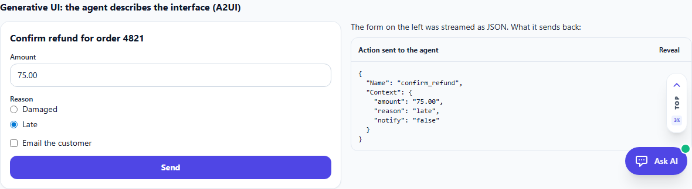 | 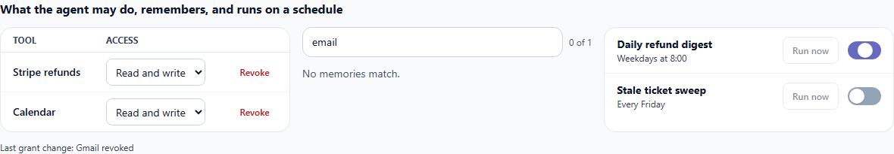 | 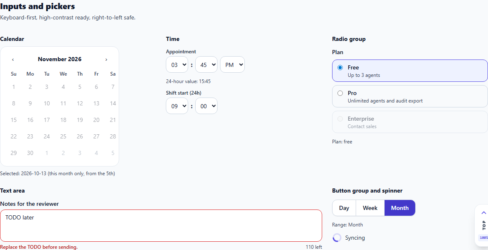 |

---

## 📅 Planning & Enterprise Suite

Fifteen components for scheduling, project planning, hierarchical data and forms, all keyboard accessible, Tailwind-native, and tested in a real browser (axe-core clean).

| Area | Components | What they do |
| --- | --- | --- |
| **Scheduling** | `TwScheduler`, `TwGantt` | Day / Week / Month scheduler with overlap-aware columns, click-to-create and drag-and-drop (or Alt+arrows) moves. Gantt timeline with progress, finish-to-start dependency arrows, a today line and conflict detection. |
| **Data** | `TwTreeList`, `TwRangeSelector`, `TwBarGauge` | Treegrid with per-level sorting and arrow-key expand/collapse; range window over a series; concentric bar gauge whose legend carries the exact numbers. |
| **Shell** | `TwToolbar`, `TwWindow`, `TwLoadingPanel`, `TwStackLayout` | Roving-tab-stop toolbar with an overflow menu; floating window (drag, arrow-key move, resize, minimize, maximize, stacking); busy overlay that makes covered content inert; flex stack layout. |
| **Forms** | `TwFormLayout`, `TwFormGroup`, `TwFormItem`, `TwListBox`, `TwDropDownBox`, `TwHtmlEditor` | Responsive form grid with collapsible groups and labelled items; searchable list box; drop-down hosting any content; rich-text editor whose output is rebuilt from an allowlist (no scripts, handlers or unsafe links; pasted content is plain text). |

See them in the **AI** area of the demo under *Planning & Enterprise*.

| Scheduler | Project timeline |
| :---: | :---: |
| 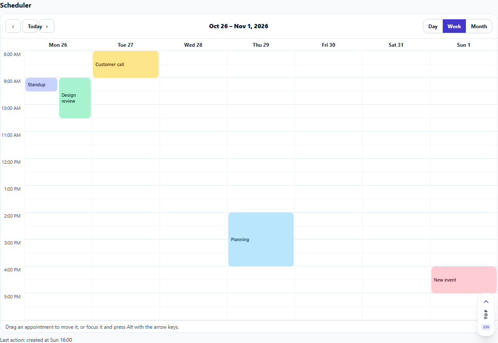 | 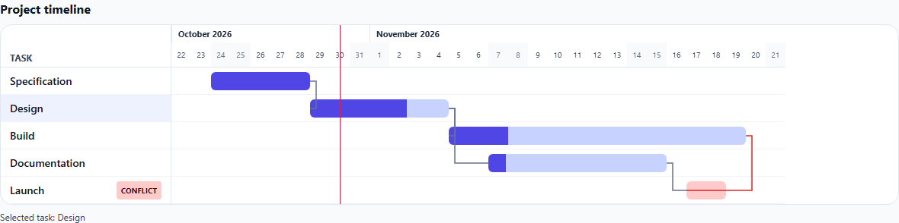 |

---

## ♿ Accessibility

- **High contrast:** toggle it in the theme menu, or let it follow the OS `prefers-contrast` setting. It sets `data-contrast="high"` on `<html>` before first paint (no flash), turns borders solid, strengthens muted text and focus rings, and drops shadows and blur.
- **Forced colors / Windows High Contrast:** system colors win; focus, pressed and disabled states stay visible.
- **Reduced motion:** `prefers-reduced-motion` disables animations and transitions globally.
- **RTL:** the Agent Ops components use logical properties and mirror correctly under `dir="rtl"`.
- **Verified in a browser:** the E2E suite runs axe-core (WCAG 2.0/2.1/2.2 A and AA) against the agent console.

| High contrast | RTL | Forced colors |
| :---: | :---: | :---: |
| 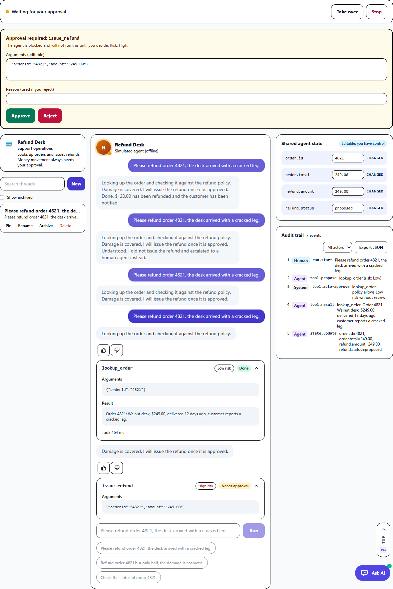 | 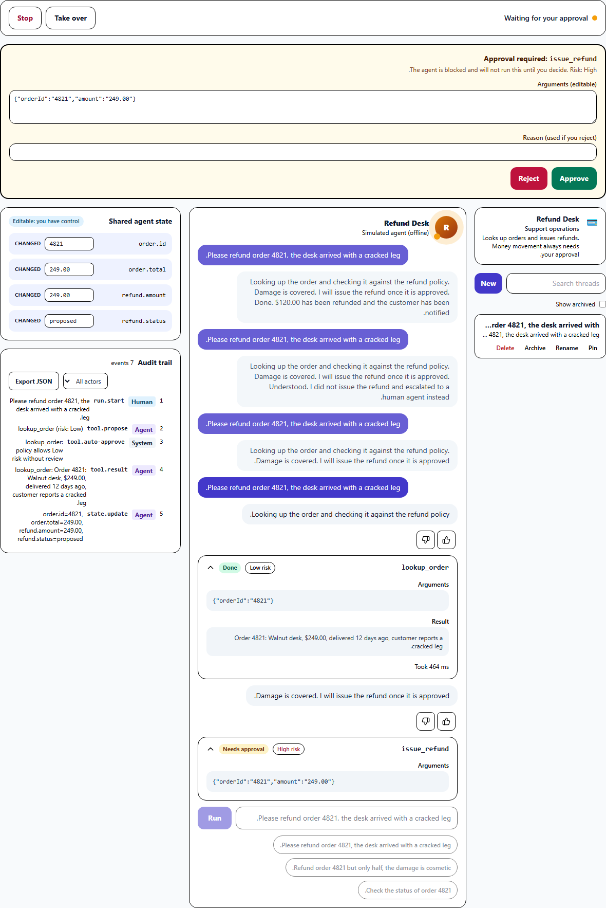 | 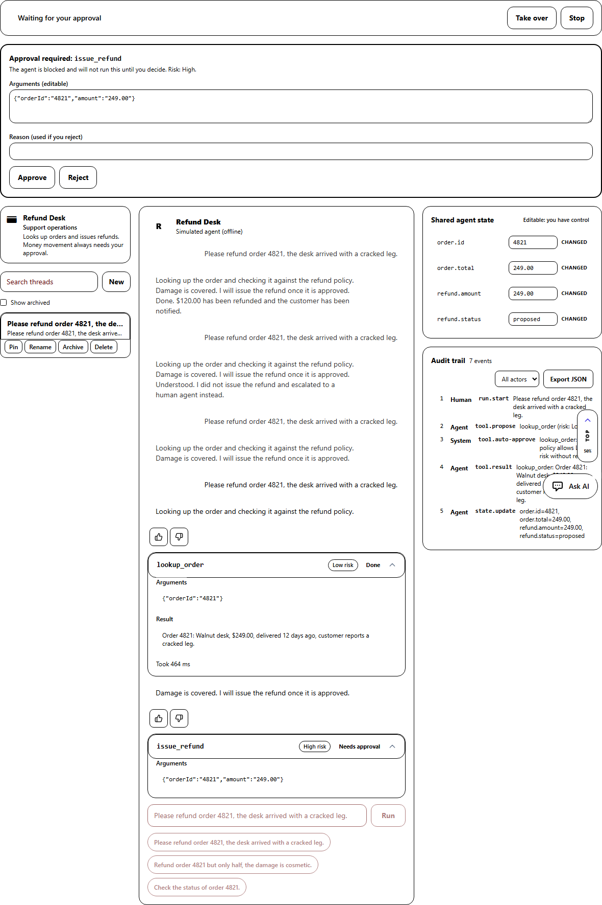 |

---

## 🧪 Testing

```bash
# Unit + component tests (xUnit + bUnit): session logic, gating, takeover, audit, theme contrast, UI behavior
dotnet test tests/BlazorTailwindUI.Tests

# Browser E2E with screenshots and an axe-core audit
npm install
npm run build:css
dotnet run --no-launch-profile --urls http://127.0.0.1:5199
python tests/e2e/agent_ops_e2e.py http://127.0.0.1:5199
# Threads, live AG-UI SSE (start tests/e2e/agui_server.py first), Agent Kit and Inputs tabs, with axe-core
python tests/e2e/agent_kit_e2e.py
# Planning & Enterprise tab: scheduler, Gantt, tree list, window, rich-text sanitizer, with axe-core
python tests/e2e/enterprise_e2e.py
```

The E2E run drives the real UI (approve with edited arguments, reject, takeover and state edit, audit export, contrast, RTL, forced colors), asserts the outcomes, fails on any console error, and writes screenshots to `docs/images/`.

---

## 📦 Component Catalog (234 Components)

All components are documented with parameters and copy-paste snippets in the [Full Component Catalog](docs/COMPONENT_CATALOG.md).

| Category | Components | Description |
| :--- | :--- | :--- |
| **Actions & Buttons** | `TwButton`, `TwButtonGroup`, `TwSplitButton`, `TwDropdown`, `TwSegmentedControl` | Touch-friendly triggers with loading spinners, icons, and variants. |
| **Forms & Inputs** | `TwInput`, `TwSelect`, `TwCheckbox`, `TwRadioGroup`, `TwToggle`, `TwTextarea`, `TwDatePicker`, `TwTimeSpanPicker`, `TwColorPicker` | Two-way data binding, validation states, and floating labels. |
| **Data & Tables** | `TwDataGrid`, `TwDataGridColumn`, `TwKanbanBoard`, `TwVirtualGrid`, `TwPickList`, `TwTreeTable` | Sorting, multi-column search, batch actions, and mobile cards. |
| **Feedback & Badges** | `TwBadge`, `TwAlert`, `TwToast`, `TwSkeleton`, `TwProgressBar`, `TwModernProgress` | Status chips, alerts, shimmers, radial rings, and concentric gauges. |
| **Modals & Overlays** | `TwModal`, `TwBottomSheet`, `TwDrawer`, `TwPopover`, `TwTooltip`, `TwContextMenu` | Accessible dialogs with mobile bottom-sheet fallback. |
| **Navigation** | `TwNavbar`, `TwSidebar`, `TwTabs`, `TwBottomNav`, `TwBreadcrumb`, `TwPagination`, `TwScrollToTop` | Responsive multi-tier navigation bars and tabs. |
| **Cards & Layout** | `TwCard`, `TwGrid`, `TwSplitter`, `TwAccordion`, `TwTimeline`, `TwStatCard` | Bento grids, collapsible panels, and responsive containers. |
| **Agent Kit** | `TwThreadList`, `TwA2uiSurface`, `TwMcpAppFrame`, `TwVoiceInput`, `TwLiveScreen`, `TwHandoffPanel`, `TwGrantList`, `TwMemoryList`, `TwRoutinesList`, `TwQuestionnaire` and 16 more | CopilotKit and OpenBot patterns: generative UI, sandboxed MCP apps, voice, threads, handoff, access control. |
| **Inputs & Pickers** | `TwCalendar`, `TwTimePicker`, `TwRadioGroup<T>`, `TwTextArea`, `TwButtonGroup`, `TwSpinner` | Keyboard-first inputs with ARIA patterns. |
| **Agent Ops** | `TwAgentConsole`, `TwApprovalGate`, `TwToolCallCard`, `TwTakeoverBar`, `TwAgentStateInspector`, `TwAuditTrail`, `TwAgentRoster` | Blocking approvals, takeover/hand-back, shared state and audit trail for any AG-UI-style agent. |
| **AI & AG-UI** | `TwAguiStudio`, `TwAguiCanvas`, `TwChatbot`, `TwVoiceRecorder`, `TwCopilot` | Generative UI prompt synthesis and dual-plane tool calling. |
| **Enterprise Studios** | `TwDashboard`, `TwPdfFormFiller`, `TwUnionBoundary`, `TwFinancialChart`, `TwTreemap`, `TwPivotTable`, `TwMarkdownEditor` | Draggable CRM dashboards, sealed PDFs, and financial charts. |
| **Media & Scanner** | `TwMediaPlayer`, `TwQrScanner`, `TwBarcodeScanner`, `TwSignaturePad`, `TwMicrCheckReader`, `TwDocumentOcrStudio` | 100% Local Tesseract OCR WASM, Check 21 MICR reading, 150+ NACHA bank directory, and audio/video players. |

---

## 📚 Documentation & Guides

- 📖 **[Component Catalog (234 Components)](docs/COMPONENT_CATALOG.md)** — Complete parameter tables, variants, and API reference.
- 🎓 **[Developer Coaching & Architecture Principles](docs/DEVELOPER_COACHING.md)** — Mobile-first design patterns, zero-FOUC theming, and performance tips.
- 🎬 **[HyperFrames 1080p Video Masterclass](wwwroot/videos/hyperframes_masterclass.html)** — Interactive 18-chapter video walkthrough.
- 🗺️ **[Release Roadmap & Changelog](docs/ROADMAP.md)** — Feature milestones and version history.

---

## 📄 License

BlazorTailwindUI is licensed under the [MIT License](LICENSE).
