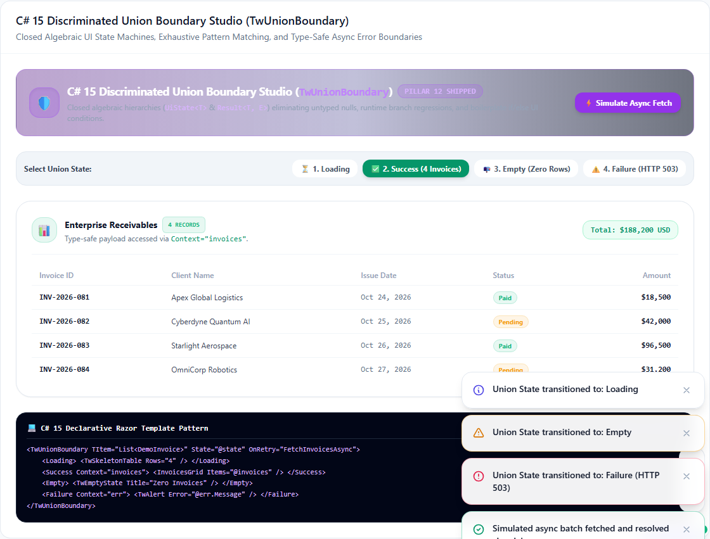
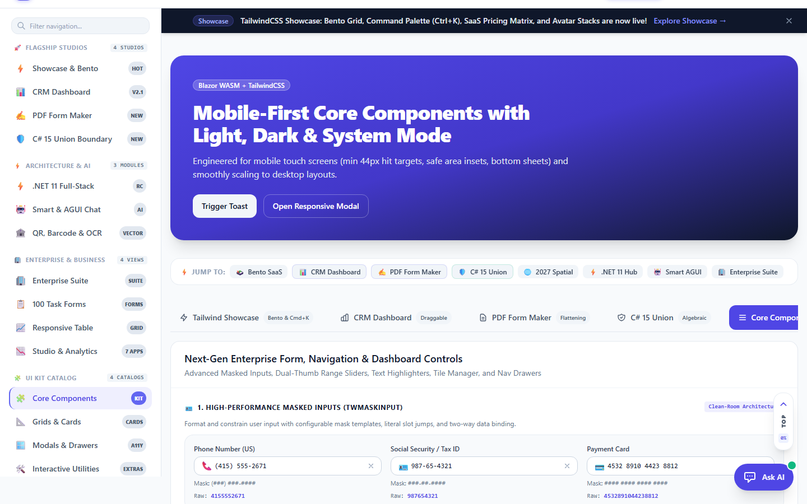
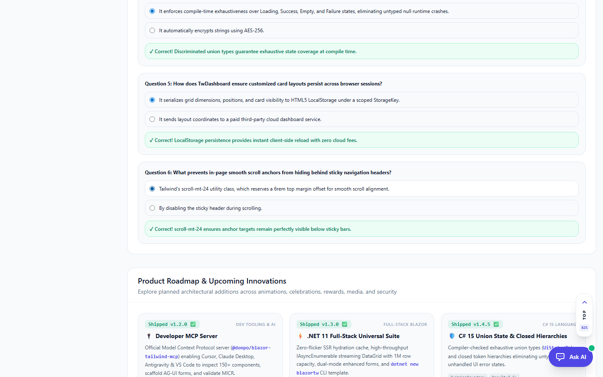
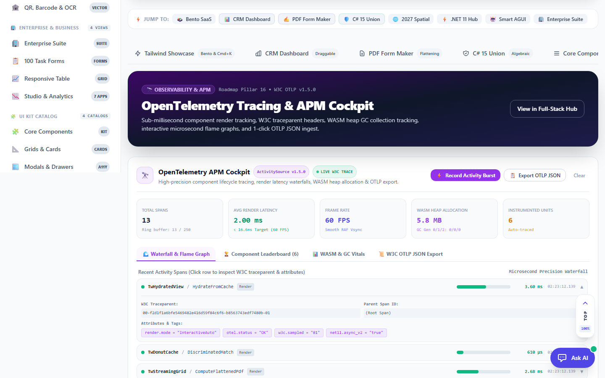

# 🗺️ Blazor Tailwind UI — Official Product Roadmap

This document outlines the strategic architecture, component specifications, and planned delivery milestones for upcoming innovations in **Blazor Tailwind UI**.

---

## 📋 Overview of Roadmap Pillars

| Pillar / Feature | Planned Component(s) | Status | Domain |
|---|---|---|---|
| **1. ScrollCraft Object Animation to Content** | `TwScrollCraft` | Shipped (v1.1.0) ✅ | UI & Micro-Interactions |
| **2. Celebration Animations Editor** | `TwCelebrationEditor` | Shipped (v1.1.0) ✅ | Interactive Creative Tools |
| **3. Celebration Randomizer for Morale Giveaways** | `TwPrizeWheel` | Shipped (v1.1.0) ✅ | Gamification & Morale |
| **4. Rewards Center for Common Offerings** | `TwRewardsCenter` | Shipped (v1.1.0) ✅ | Enterprise HR & Operations |
| **5. Native Media Recorder & Player** | `TwMediaRecorder` | Shipped (v1.1.0) ✅ | Hardware & Media Interop |
| **6. Multi-Factor Auth (MFA) Methods Suite** | `TwMfaAuthSuite`, `TwOtpInput` | Shipped (v1.1.0) ✅ | Security, Auth & Compliance |
| **7. AG-UI Form Engine & HITL Workbenches** | `TwAguiFormCanvas`, `AguiFormSchema` | Shipped (v1.1.0) ✅ | Agentic AI & Generative UI |
| **8. PWA 1-Click App Installer** | `TwPwaInstallButton`, `TwPwaService` | Shipped (v1.1.0) ✅ | Client WebAssembly & Mobile |
| **9. Form / PDF OCR & Check 21 MICR Engine** | `TwMicrCheckReader`, `TwDocumentOcrStudio`, `TwSmartOcrButton` | Shipped (v1.2.0) ✅ | Client WebAssembly & FinTech |
| **10. Developer MCP Server** | `@donpo/blazor-tailwind-mcp` | Shipped (v1.2.0) ✅ | Developer Tooling & Agentic AI |
| **11. .NET 11 Full-Stack Universal Suite** | `TwStreamingGrid`, `TwHydratedView`, `TwFullstackForm`, `TwFullstackHub` | Shipped (v1.3.0) ✅ | Full-Stack Blazor & Telemetry |
| **12. C# 15 Discriminated Unions & Closed Hierarchies** | `TwUnionBoundary`, `Result<T, E>`, `TwAsyncState`, `TwUnionStudio` | Shipped (v1.4.5) ✅ | Language Modernization & State Safety |
| **13. Donut Caching & ShortCircuit Edge Endpoints** | `TwDonutCache`, `TwCacheHole`, `TwShortCircuit` | Planned (v1.4.0) 🚀 | SSR Performance & Edge Caching |
| **14. Native Zstandard Ultra-Fast Compression** | `TwZstdStreamService`, `TwZstdPayloadBridge` | Planned (v1.4.0) 🚀 | High-Throughput Data & Transport |
| **15. Post-Quantum Cryptography & ML-KEM Vault** | `TwPostQuantumVault`, `TwHpkeEnclave` | Planned (v1.4.0) 🚀 | Zero-Trust & Post-Quantum Security |
| **16. Native OpenTelemetry Component Tracing** | `TwTelemetryDashboard`, `TwActivityMeter` | Planned (v1.4.0) 🚀 | Observability & Performance HUD |
| **17. .NET Aspire 11 Live App Host Orchestration** | `Aspire.Hosting.BlazorTailwindUI` | Planned (v1.5.0) 🌐 | Cloud-Native & Developer Velocity |
| **18. Runtime-Native Async V2 & Hardware Acceleration** | `TwVectorMath`, `TwSIMDEngine` | Planned (v1.5.0) 🌐 | Runtime Performance & Vector SIMD |
| **19. Enterprise Form & Workspace Suite** | `TwMaskInput`, `TwRangeSlider`, `TwHighlight`, `TwTileManager`, `TwNavDrawer` | Shipped (v1.3.1) ✅ | Enterprise UX & Dashboards |

---

## 1. 📜 ScrollCraft Object Animation to Content

### Objective
Provide smooth, hardware-accelerated scroll-driven animations that anchor UI elements, illustrations, and callout cards to scroll progress without heavy external JS animation bundles (like GSAP or ScrollMagic).

### Key Architectural Specifications
- **`TwScrollCraft`**: Parent wrapper tracking viewport intersection thresholds (`IntersectionObserver` + CSS `animation-timeline: view()` and `animation-timeline: scroll()`).
- **Dynamic Physics Hooks**:
  - `ScrollEffect.Parallax`: Multi-layer depth shifting on background/foreground layers.
  - `ScrollEffect.PinAndScrub`: Pins an illustration or mock device in place while bullet points scrub through.
  - `ScrollEffect.FadeZoomIn`: Element scales from `0.9` to `1.0` with opacity fade as it enters the focal reading zone.
  - `ScrollEffect.PathMorph`: SVG path `d` attribute interpolation linked to scroll position.
- **Pure CSS Fallbacks**: Gracefully falls back to standard CSS transitions for browsers without scroll-timeline support.

```razor
<TwScrollCraft Effect="ScrollEffect.PinAndScrub" ScrubDistance="400" TriggerHook="0.3">
    <PinnedContent>
        <TwFeatureMockup Device="DeviceKind.Laptop" />
    </PinnedContent>
    <ScrollSteps>
        <TwScrollStep Title="Sub-millisecond Sorting" Description="..." />
        <TwScrollStep Title="Dual-Plane Latency Meters" Description="..." />
    </ScrollSteps>
</TwScrollCraft>
```

---

## 2. 🎆 Celebration Animations Editor

### Objective
A visual developer workbench that lets engineers and designers fine-tune confetti bursts, fireworks, and celebration physics live in the browser, with one-click export to copy-pasteable Blazor markup and JSON schemas.

### Key Architectural Specifications
- **`TwCelebrationEditor`**: Split-pane visual studio:
  - **Live Physics Viewport**: HTML5 Canvas running 60fps particle physics simulation.
  - **Parameter Sliders**:
    - Particle Count (`20` to `500`)
    - Velocity / Initial Force (`5` to `50` px/frame)
    - Spread Angle (`15°` to `360°`)
    - Gravity Simulation (`0.1` to `2.0` m/s²)
    - Wind Drift & Drag Coefficient
    - Decay / Fade Lifetime (`1.0s` to `8.0s`)
  - **Custom Particle Shapes**:
    - Traditional rectangular paper confetti
    - Star bursts & Golden coins (Corporate awards)
    - Custom SVG brand shapes & Emojis (`🎉`, `⭐`, `🚀`, `💎`, `🍕`)
  - **Code Exporter**: 1-click generation of `<TwConfetti ParticleCount="..." Spread="..." ... />` or C# `await Confetti.FireAsync(options);`.

---

## 3. 🎲 Celebration Randomizer for Game Prize Giveaways (Team Morale)

### Objective
Turn company parties, sprint retrospective celebrations, and all-hands town halls into engaging team moments with interactive, high-morale prize giveaway games.

### Key Architectural Specifications
- **`TwPrizeRandomizer` / `TwPrizeWheel`**:
  - **Spinning Fortune Wheel**: SVG segment wheel with dynamic wedge weighting, sound-effect cues, acceleration physics, and decelerating tick pointers.
  - **Lucky Card Flip & Match**: Memory card flip reveal with spot prize badges.
  - **Loot Box / Mystery Chest Unlocker**: 3D CSS chest opening animation accompanied by dynamic confetti explosion and winner banner.
- **Customizable Giveaway Pool**:
  - Weighted probabilities (e.g. Common: "Company Tumbler", Rare: "$50 Coffee Card", Legendary: "Extra Friday Off").
  - CSV/JSON roster import: Automatically load employee or attendee rosters to pick fair random winners with "Already Won" exclusion toggles.
  - Sound Effects: Pure Web Audio API synthesized celebratory chime and drumroll without remote MP3 downloads.

---

## 4. 🎁 Rewards Center for Most Common Rewards Offerings

### Objective
An end-to-end enterprise employee perks and recognition redemption catalog that seamlessly pairs with `TwEmployeeAwardForm` and spot bonus disbursements.

### Key Architectural Specifications
- **`TwRewardsCenter`**:
  - **Category Tabs**:
    1. *Gift Cards & Dining* (Coffee shops, delivery apps, online retail, experiences)
    2. *Company Swag & Gear* (Branded hoodies, mechanical keyboards, ergonomic backpacks)
    3. *Workplace Flexibility* (Extra Floating Holiday, Half-Day Friday Pass, Remote Tech Stipend)
    4. *Learning & Conferences* (Book budget, course subscriptions, summit tickets)
    5. *Charitable Giving* (Dollar-for-dollar corporate donation matches)
  - **Points / Budget Wallet Ledger**: Live balance tracker showing available recognition points or allocated reward currency.
  - **Redemption Flow (`TwRedemptionModal`)**:
    - Item selection with instant confirmation, digital voucher generation, and redemption email webhook dispatch.
    - Tiered access and budget guardrails for managers and team leads.

---

## 5. 🎙️ Media Recorder & Player Suite

### Objective
Expand the existing `TwMediaPlayer` with native browser recording capabilities via the W3C MediaStream and MediaRecorder APIs for async standups, video bug reports, and audio podcast recording.

### Key Architectural Specifications
- **`TwMediaRecorder`**:
  - **Capture Modes**:
    - `MediaMode.AudioOnly`: Microphone recording with live SVG frequency bars and waveform visualizer.
    - `MediaMode.VideoCamera`: HD webcam video recording with camera switcher (front/rear/external).
    - `MediaMode.ScreenShare`: In-browser screen capture with optional picture-in-picture webcam bubble.
  - **Runtime Features**:
    - Audio level meters (VUMeter) to prevent clipping.
    - Pause, resume, and instant trim preview.
    - Client-side blob encoding to WebM / MP4 with one-click local download or upload callback (`EventCallback<byte[]>`).
  - **Integrated Player Link**: Captured recording instantly binds into `TwMediaPlayer` for chapter bookmarking and playback speed adjustment.

---

## 6. 🔐 Multi-Factor Authentication (MFA) Methods Suite

### Objective
Provide enterprise security engineers with modern, drop-in multi-factor authentication controls compliant with NIST 800-63B and zero-trust guidelines.

### Key Architectural Specifications
- **`TwMfaAuthSuite`**:
  - **Method 1: TOTP Authenticator Apps (`TwTotpSetup`)**:
    - Vector QR code display for scanning with authenticator apps.
    - Formatted secret key with 1-click clipboard copy.
    - Six-digit verification code input with immediate auto-submit upon entering the 6th digit.
  - **Method 2: SMS / Email OTP (`TwOtpInput`)**:
    - Segmented 6-box PIN input with automatic focus advance, backspace regression, and paste handling.
    - Cooldown countdown timer for resending codes (`Resend code in 45s`).
  - **Method 3: Passkeys & WebAuthn / FIDO2 (`TwPasskeyAuth`)**:
    - Hardware security keys (YubiKey), biometric Touch ID / Face ID, and Windows Hello.
    - Navigator credentials API interop with fallback to TOTP.
  - **Method 4: Emergency Backup Recovery Codes (`TwRecoveryCodes`)**:
    - 8× 10-character alphanumeric single-use recovery codes.
    - Print-friendly layout and text file download.

---

## 7. 🤖 Adaptive Generative UI (AG-UI) Form Engine & HITL Workbenches

### Objective
Eliminate the tedious "Chat Wall" ping-pong by allowing AI agents to synthesize runtime-adaptive, validated forms directly into the conversation or side-drawer, complete with human-in-the-loop (HITL) approval gates, confidence chips, and type-safe tool callbacks.

### Key Architectural Specifications
- **`TwAguiFormCanvas`**: High-performance, reactive form engine executing entirely in client WebAssembly.
  - **Dynamic Field Compilation**: Synthesizes inputs, textareas, sliders, numeric steppers, switches, radio groups, date pickers, and tags on the fly from an `AguiFormSchema`.
  - **Conditional Dependency Evaluation**: Fields dynamically appear or hide based on user selections (`DependsOnField`, `DependsOnValue`) without page reload.
  - **Confidence Badges & Source Hints**: Fields pre-populated by AI display confidence ratings (`✨ 98%`) and hover tooltips showing source citations (*"Extracted from Quote Header Page 1"*).
  - **Two-Way Diff Inspector**: Live JSON drawer tracking user deviations from agent proposals, with 1-click `✨ Reapply AI Defaults`.
  - **Procedural Sound FX & HITL Resolution**: Submitting triggers procedural fanfare (`TwSoundService`), packaging structured parameters into an `AguiFormSubmission` to unblock agent workflows.

```razor
<TwAguiFormCanvas Schema="@schema" 
                  OnSubmit="HandleApproval" 
                  OnCancel="HandleRejection" />
```

---

## 8. 📲 Progressive Web App (PWA) 1-Click App Installer

### Objective
Allow users and enterprise stakeholders to install the entire Blazor WebAssembly demo as a standalone native desktop or mobile application directly from their browser with zero URL bar clutter and offline caching.

### Key Architectural Specifications
- **`manifest.webmanifest`**: Declares standalone display mode, orientation, background color, theme color, and high-resolution icons (SVG, 192px PNG, 512px maskable PNG).
- **`service-worker.js`**: Pre-caches the WebAssembly runtime, Tailwind stylesheets, Web Audio sound synthesizers, and icons for fast offline startup.
- **`TwPwaInstallButton`**: Reactive Blazor button component listening to `beforeinstallprompt` and `appinstalled` events via `TwPwaService`.
- **Cross-Platform Modal**: Explains 1-click install for Chrome/Edge and step-by-step guidance for iOS Safari (*"Share ➔ Add to Home Screen"*).

```razor
<TwPwaInstallButton />
```

---

## 9. 🏦 Form / PDF OCR & Check 21 MICR Detection Engine

### Objective
Provide client-side WebAssembly optical character recognition (OCR) and financial document intelligence for paper checks, bank drafts, invoices, and tax forms with ANSI X9.27 / ISO 1004 E-13B magnetic ink decoding and automated Federal Reserve routing checksum verification.

### Key Architectural Specifications
- **`TwMicrCheckReader`**: Interactive Check 21 Remote Deposit Capture (RDC) visual check canvas:
  - **MICR E-13B Decoding**: Parses Transit (`⑆`), On-Us (`⑈`), Amount (`⑇`), and Dash (`⑉`) magnetic glyphs.
  - **Federal Reserve Mod-10 ABA Checksum**: Real-time algorithm `[3(d1+d4+d7) + 7(d2+d5+d8) + 1(d3+d6+d9)] mod 10 == 0`.
  - **Courtesy vs Legal Amount Verification**: Compares numeric box with written legal words to prevent deposit discrepancies.
- **`TwDocumentOcrStudio`**: Multi-document studio with spatial bounding boxes for Invoices, Paper Checks, and IRS Form W-9.
- **`TwSmartOcrButton`**: Drop-in Smart Component button mapping document entities directly into form inputs.
- **`TwMarkdownEditor` Integration**: Dedicated `📄 OCR / MICR` toolbar drawer inserting Check 21 ledger and invoice Markdown tables at cursor.

```razor
<TwMicrCheckReader OnCheckScanned="HandleCheck" OnInsertMarkdown="HandleInsert" />
<TwDocumentOcrStudio OnMarkdownExtracted="HandleMarkdown" />
<TwSmartOcrButton OnDocumentScanned="HandleDoc" OnCheckScanned="HandleCheck" />
```

---

## 10. 🔌 Developer Model Context Protocol (MCP) Server (`@donpo/blazor-tailwind-mcp`) — Shipped (v1.2.0) ✅

### Objective
Provide an official, zero-friction **Model Context Protocol (MCP)** server for AI-assisted developer environments (Cursor, Claude Desktop, Antigravity, VS Code Copilot, and Windsurf). Enables developer coding assistants to query the 147+ component library, inspect typed parameter schemas, generate validated AG-UI form JSON, validate ANSI X9.27 MICR lines, and lint Razor markup in real time.

### Key Architectural Specifications
- **Packaging & Transports**:
  - Packaged as a zero-dependency CLI runner: `npx @donpo/blazor-tailwind-mcp` or `dotnet run --project BlazorTailwindUI.Mcp`.
  - Supports standard STDIO and SSE (Server-Sent Events) transports for local IDE and containerized agentic workflows.
- **MCP Tools**:
  - `blazortw_search_components`: Queries all 147+ components by natural language intent (e.g. *"I need a check reader with MICR"*, *"show me a financial pivot grid"*), returning full parameter docs and Razor markup.
  - `blazortw_get_component_api`: Returns the typed C# parameters, events (`EventCallback<T>`), and default values for any component.
  - `blazortw_scaffold_form`: Generates production-ready `AguiFormSchema` or `TwFormEngine` JSON schemas and C# models for any enterprise domain.
  - `blazortw_validate_micr`: Evaluates ANSI X9.27 MICR lines and calculates Federal Reserve Mod-10 ABA routing checksums.
  - `blazortw_audit_markup`: Analyzes Razor files for mobile-first touch compliance (44px tap targets), zero third-party commercial UI dependencies, and dark-mode styling synchronization.
- **MCP Resources**:
  - `blazortw://components/catalog`: Real-time machine-readable catalog of all 147+ components.
  - `blazortw://forms/100-standard`: The 100 enterprise form schemas across 10 functional domains.
  - `blazortw://design/tokens`: Tailwind utility classes, design tokens, and animation presets.
- **MCP Prompts**:
  - `scaffold-enterprise-page`: Orchestrates end-to-end scaffolding of a full-stack Blazor WASM page adhering to design system guidelines.
  - `synthesize-agui-agent`: Guides backend LLM agents in outputting type-safe `AguiWidgetSchema` and `AguiFormSchema` JSON trees.

#### Claude Desktop & Cursor Configuration Snippet
```json
{
  "mcpServers": {
    "blazor-tailwind": {
      "command": "npx",
      "args": ["-y", "@donpo/blazor-tailwind-mcp"]
    }
  }
}
```

---

## 11. ⚡ .NET 11 Full-Stack Blazor Enterprise Suite & Universal Render Modes — Shipped (v1.3.0) ✅

### Objective
Provide comprehensive, first-class full-stack development support for **.NET 11 GA (November 10)**, unifying Static Server Rendering (SSR), Streaming SSR, Interactive Server, and Interactive WebAssembly into a cohesive enterprise architecture with zero double-fetch hydration flicker and high-throughput streaming.

### Key Architectural Specifications
- **`TwHydrationService` & `TwHydratedView`**:
  - Implements cryptographically verified state transfer between server prerender and client hydration.
  - Eliminates duplicate database and API queries during hydration, saving 200–500ms of latency per page load and preventing UI flicker.
- **`TwStreamingGrid<T>`**:
  - Consumes native `IAsyncEnumerable<T>` server streams directly with real-time arrival pulse animations.
  - Virtualized viewport capable of displaying 1,000,000 records smoothly at 60fps.
  - Live controls: speed throttle selector (20ms–500ms), stream pause/resume, high-density table vs mobile card view toggle, and search filtering.
- **`TwFullstackForm`**:
  - Dual-mode form engine supporting both Static SSR Enhanced POST (`data-enhance`) and Interactive Auto direct client RPC.
- **Official CLI Scaffolder**:
  - `dotnet new install https://github.com/donpotts/BlazorTailwindUI.git`
  - `dotnet new blazortw -n MyEnterpriseApp --render-mode auto`

---

## 12. 🛡️ C# 15 Discriminated Union Types & Closed Hierarchies (`TwUnionBoundary`, `Result<T, E>`) — Shipped (v1.4.5) ✅

### Objective
Leverage modern C# 15 language innovations—specifically **first-class Union Types** and **Closed Class Hierarchies** (`closed`)—to eliminate untyped nullable models, runtime exceptions, and sentinel flags in asynchronous Blazor component state machines.

### Key Architectural Specifications
- **`public union UiState<T>`**:
  - Expresses UI states as closed algebraic data types with built-in compiler exhaustiveness checks:
    ```csharp
    public union UiState<T>(
        Loading,
        Success(T Data),
        Empty,
        Failure(string Message, Exception? Exception)
    );
    ```
- **`TwUnionBoundary<TUnion>`**:
  - Declarative Razor container mapping union cases to type-safe child templates. The C# 15 compiler validates that all cases are handled, preventing unhandled runtime branch regressions:
    ```razor
    <TwUnionBoundary State="@invoiceState">
        <Loading>
            <TwSkeletonCard Rows="5" />
        </Loading>
        <Success Context="invoice">
            <TwInvoiceViewer Model="@invoice" />
        </Success>
        <Empty>
            <TwEmptyState Title="No Invoices Found" ActionLabel="Create Invoice" />
        </Empty>
        <Failure Context="err">
            <TwAlert Variant="AlertVariant.Danger" Message="@err.Message" />
        </Failure>
    </TwUnionBoundary>
    ```
- **Closed Component Prop Hierarchies (`closed`)**:
  - Restricts direct inheritance of design-system base tokens and button variants, enforcing compile-time validation that only approved theme tokens are instantiated.

---

## 13. 🍩 Blazor Donut Caching & High-Performance `[ShortCircuit]` Edge Endpoints

### Objective
Harness the .NET 11 **CacheViewComponent** / Donut Caching engine for Static Server-Side Rendering (SSR) and streaming pipelines, enabling Blazor applications to edge-cache 95%+ of complex rendered markup while dynamically perforating and updating personalized "donut holes" (e.g. shopping cart badges, user greetings, live stock tickers) without rerendering static shells.

### Key Architectural Specifications
- **`TwDonutCache` & `TwCacheHole`**:
  - Encloses static UI regions (navigation headers, enterprise data tables, documentation trees) with configurable cache profiles (duration, sliding expiration, tag-based cache eviction).
  - Isolates dynamic slots (`<TwCacheHole Name="UserCart">`) evaluated on-demand per request.
- **`[ShortCircuit]` Performance Endpoints**:
  - Connects interactive components to lightweight ASP.NET Core `[ShortCircuit]` endpoints that bypass full middleware pipeline passes (authentication loops, logging chains, session parsing) for ultra-low-latency component micro-payload updates (< 1ms execution time).
- **Tag-Based Cache Busting**:
  - Exposes `TwCacheEvictionService` enabling one-click programmatic cache invalidation across distributed server nodes upon data mutation.

```razor
<TwDonutCache CacheKey="catalog_grid_page1" DurationSeconds="300" Tags="@(["catalog", "inventory"])">
    <TwDataGrid Items="@staticProducts" />
    
    <TwCacheHole Id="user-pricing">
        <TwDynamicPricingBadge ProductId="@selectedId" />
    </TwCacheHole>
</TwDonutCache>
```

---

## 14. 🗜️ Ultra-Fast Native Zstandard Compression Pipeline (`TwZstdStreamService`)

### Objective
Incorporate native .NET 11 **ZstandardStream** support into Blazor Tailwind UI's transport layer, providing 2–7x faster compression and drastically faster decompression than traditional GZip or Brotli for high-density streaming DataGrids, SignalR state transfer, and offline IndexedDB snapshots.

### Key Architectural Specifications
- **`TwZstdStreamService`**:
  - WebAssembly SIMD-accelerated Zstandard decompression engine running client-side.
  - Server-side streaming compressor streaming `IAsyncEnumerable<T>` records directly to `TwStreamingGrid`.
- **Bandwidth & CPU Optimization**:
  - Delivers up to 70% reduction in transmitted bytes for large JSON schemas, Check 21 OCR coordinate batches, and AG-UI form submission trees.
  - Near-zero client CPU overhead during decompression, ideal for battery-constrained mobile devices.
- **Automatic Content Negotiation**:
  - Transparently falls back to Brotli or GZip for legacy browser clients without client-side WebAssembly SIMD or Zstandard decoders.

---

## 15. 🔐 Post-Quantum Cryptography & ML-KEM Secure State Enclaves (`TwPostQuantumVault`, `TwHpkeEnclave`)

### Objective
Equip enterprise Blazor applications with quantum-resistant data protection utilizing .NET 11's newly introduced **ML-KEM (Module-Lattice-Based Key-Encapsulation Mechanism)** and **HPKE (Hybrid Public Key Encryption)** APIs, securing sensitive enterprise inputs (payroll bonuses, medical notes, Check 21 MICR tokens) against future "harvest now, decrypt later" attack vectors.

### Key Architectural Specifications
- **`TwPostQuantumVault`**:
  - Client-side cryptographic enclave encrypting sensitive form fields before dispatching to backend storage or local IndexedDB persistence.
  - Generates and negotiates ephemeral ML-KEM-768 key pairs between the Blazor client and server.
- **`TwHpkeEnclave`**:
  - One-click authenticated encryption for REST and SignalR payloads with zero third-party crypto dependencies.
- **Enterprise Compliance Badges**:
  - Visual security badges (`🛡️ Post-Quantum Protected (ML-KEM-768)`) displayed on sensitive AG-UI form surfaces.

```razor
<TwPostQuantumVault Algorithm="PqcAlgorithm.ML_KEM_768">
    <TwAguiFormCanvas Schema="@sensitivePayrollSchema" OnSubmit="HandleSecureSubmission" />
</TwPostQuantumVault>
```

---

## 16. 📊 Native OpenTelemetry Component Tracing & Developer Cockpit (`TwTelemetryDashboard`, `TwActivityMeter`)

### Objective
Integrate first-class **OpenTelemetry (OTel)** metrics, activity tracing (`ActivitySource`), and diagnostic meters into every layer of Blazor Tailwind UI, providing deep visibility into component rendering cycles, hydration timings, streaming DataGrid throughput, and MCP server tool invocations.

### Key Architectural Specifications
- **Standardized OTel Instruments**:
  - `blazortw.component.render_duration` (Histogram: duration of `BuildRenderTree` and lifecycle hooks in microseconds).
  - `blazortw.hydration.cache_hit_ratio` (Counter: SSR cache hits vs cold roundtrips).
  - `blazortw.streaming_grid.throughput` (Gauge: incoming rows/second).
  - `blazortw.mcp.tool_execution` (Histogram: duration and success rate of MCP tools).
- **`TwTelemetryDashboard`**:
  - Slide-over developer HUD rendering real-time performance graphs, memory allocation trends, and OpenTelemetry trace spans directly inside development environments.
  - Zero production footprint when disabled via preprocessor directives or configuration flags.

---

## 17. 🌐 .NET Aspire 11 Live App Host Orchestration (`Aspire.Hosting.BlazorTailwindUI`)

### Objective
Integrate Blazor Tailwind UI natively into the **.NET Aspire 11** cloud-native ecosystem with seamless `dotnet watch` live hot-reload across distributed multi-project solutions.

### Key Architectural Specifications
- **`Aspire.Hosting.BlazorTailwindUI` NuGet Package**:
  - Single-line integration in Aspire `AppHost`:
    ```csharp
    var builder = DistributedApplication.CreateBuilder(args);
    
    var cache = builder.AddRedis("cache");
    var api = builder.AddProject<Projects.EnterpriseApi>("api")
                     .WithReference(cache);
                     
    builder.AddBlazorTailwindApp("frontend", api)
           .WithMcpServer()
           .WithDonutCaching();
           
    builder.Build().Run();
    ```
- **Unified Tooling**:
  - Seamlessly connects the `@donpo/blazor-tailwind-mcp` developer server, distributed OpenTelemetry collectors, and client WebAssembly hot reload into the Aspire Developer Dashboard.

---

## 18. ⚡ Runtime-Native Async V2 & Hardware Acceleration Baselines

### Objective
Harness .NET 11's **Runtime-Native Async V2** model and modern hardware baseline enhancements (x86-64-v3, Arm64 LSE, and SVE2 math instructions) to unlock maximum throughput with zero state-machine heap allocations.

### Key Architectural Specifications
- **Runtime-Native Async V2 Integration**:
  - Refactors core asynchronous event callbacks and JS interop pipelines to take advantage of native runtime-level async, eliminating legacy compiler-generated `<>c__DisplayClass` state-machine allocations.
  - Cleaner asynchronous call stacks and accelerated NativeAOT compilation support.
- **Hardware-Accelerated Vector Algorithms**:
  - Leverages SVE2 and AVX2 SIMD intrinsics for real-time Check 21 MICR image cross-correlation, fast sorting in `TwDataGrid`, and instant client-side CSV parsing.
  - Bounds check elimination and generic method devirtualization across high-density data collections.

---

## 19. 🎛️ Enterprise Form & Workspace Suite — Shipped (v1.3.1) ✅

### Objective
Provide clean-room, zero-dependency Tailwind CSS + Blazor components addressing high-demand enterprise requirements: masked data entry, continuous interval bounds selection, document text search highlights, executive KPI tile management, and compact side navigation drawers.

### Key Architectural Specifications
- **`TwMaskInput`**:
  - Configurable mask templates (`(###) ###-####`, `###-##-####`, `#### #### #### ####`, `##/##/####`).
  - Dual value modes: `Raw` (unformatted digits) vs `WithFormatting` (formatted string with mask literals).
  - Cursor jumping over literal characters and prompt indicators.
- **`TwRangeSlider`**:
  - Dual-handle range selector with lower and upper thumb bounds.
  - Colored gradient track fill between active thumbs with ticks and prefix/suffix formatting.
  - Mobile touch-optimized 44px hit targets.
- **`TwHighlight`**:
  - Real-time text search highlighter supporting case sensitivity and whole-word matching.
  - Active match indicator (`Match 2 of 5`) and next/previous match cycling buttons.
- **`TwTileManager` & `TwTile`**:
  - Operational KPI tile layout manager with responsive grid column counts (Quad, Triple, Dual).
  - 1-click Focus Mode Maximize with modal overlay backdrop and minimize collapse.
- **`TwNavDrawer` & `TwNavDrawerItem`**:
  - Collapsible side navigation drawer supporting instant toggle between Mini icon rail (64px) and Expanded full sidebar (260px).
  - Item badge notifications (`Live`, `159`, `New`) and active route indicator.

---

### Pillar 20: Conversational AI & Floating Context Suite (Shipped v1.3.2 ✅)


Clean-room engineered enterprise conversational AI studio, floating anchored popover overlays, and dismissible actionable snackbars inspired by modern UI specifications:
- **`TwChatStudio`**:
  - Full-featured conversational AI studio with multi-turn message timeline (user vs assistant bubbles).
  - Staged file attachment drawer with badge icons, filenames, formatted byte sizes, and staging removal.
  - Quick reply suggestion chips positioned above composer for 1-click prompt dispatch.
  - Message action toolbar: copy to clipboard, persistent feedback reactions (thumbs up/down), and response regeneration.
  - 3-dot harmonic pulsing typing indicator with customizable status text.
  - Multiline auto-growing composer with Enter/Shift+Enter keyboard bindings and character counter.
- **`TwPopover`**:
  - Anchored contextual flyout with directional pointer arrow and 8-way placement (`Top`, `Bottom`, `Left`, `Right`, etc.).
  - Click and hover activation triggers with transparent outside click dismiss and keyboard <kbd>Escape</kbd> dismissal.
  - Header, child content, and footer action slots.
- **`TwSnackbar`**:
  - Actionable floating notification banner with secondary trigger button (e.g. *Undo*, *Retry*, *View Log*).
  - Animated auto-dismiss countdown progress timer bar with automatic pause when hovered by the mouse pointer.
  - 5 semantic variants (Default, Success, Warning, Danger, Info) across 6 viewport anchoring positions.

---

### Pillar 21: PickList, Duration Stepper & Virtual Keypad Suite (Shipped v1.3.3 ✅)


Clean-room engineered enterprise dual-list transfer picklists, precision duration steppers, and touchscreen kiosk virtual keypads inspired by modern full-stack UI specifications:
- **`TwPickList<TItem>`**:
  - Dual-listbox item transfer picker between Available (`Source`) and Selected (`Target`) collections.
  - Real-time client-side dual search filtering on both panels with match count badges.
  - Batch transfer actions: Move Selected (`>`), Return Selected (`<`), Transfer All (`>>`), and Return All (`<<`).
  - Target list item reordering (`Move Up` / `Move Down`) and double-click immediate transfer shortcut.
- **`TwTimeSpanPicker`**:
  - Precision duration steppers for Days, Hours (0-23), Minutes (0-59), and Seconds (0-59).
  - Spin stepper up/down controls with direct numeric keyboard editing.
  - Quick duration presets bar (`15m`, `30m`, `1h`, `4h`, `1d`, `7d`, `30d`) and 1-click zero reset.
  - Live formatted summary badge (e.g. `2d 4h 30m 0s`).
- **`TwVirtualKeyboard`**:
  - Multi-layout on-screen keyboard supporting `QWERTY` alpha-numeric, `Numeric` calculator pad, and `Secure PIN` pad.
  - Anti-shoulder-surfing dynamic randomized key scrambling for touchscreen kiosks and POS terminals.
  - Password bullet masking (`••••`), Caps Lock with illuminated LED state, and Enter/Submit callback.

---

### Pillar 22: Storage Manager, Word Cloud & Sankey Flow Suite (Shipped v1.3.4 ✅)


Clean-room engineered enterprise cloud file asset managers, pure SVG keyword density clouds, and multi-stage throughput Sankey flow diagrams inspired by high-end analytics specifications:
- **`TwFileManager`**:
  - Enterprise cloud file explorer with left folder navigation tree and dynamic breadcrumb bar.
  - Dual view modes: visual Grid cards vs sortable List/Table view with file sizes, types, and modification timestamps.
  - Search filter bar, cloud storage quota utilization meter, and file action callbacks (upload, download, delete).
- **`TwWordCloud`**:
  - Pure SVG keyword density and term frequency cloud powered by an Archimedean spiral placement algorithm.
  - Dynamic weight-based font size interpolation (`MinFontSize` to `MaxFontSize`) with zero third-party script dependencies.
  - Harmonic palette distribution, hover scale transformations, and interactive selection callbacks.
- **`TwSankeyChart`**:
  - Multi-stage pipeline and resource flow diagram with source/target column layouts and cubic bezier gradient ribbons.
  - Proportional ribbon thickness scaled to flow volume with interactive node click and ribbon inspection.

---

### Pillar 23: 2027 Next-Gen Spatial & Anticipatory UI Laboratory (Shipped v1.3.5 ✅)


A comprehensive paradigm shift translating the 2024-to-2027 modern UI transition into production Blazor WebAssembly components without bulky WebGL dependencies:

| Feature Dimension | 2024 (Conventional) | 2027 (Shipped in BlazorTailwindUI) |
|---|---|---|
| **Structure** | Static Pages / Isolated Components | Generative / Dynamic Morphing Layouts |
| **Dimension** | 2D Flat / Stacked Layers | 3D Volumetric / Spatial Depth |
| **Interaction** | Tap, Swipe, Click | Gaze Tracking, Biometric Touch Resonance, Neural Intent |
| **Logic** | User manually navigates app | App anticipates user intent ("States over Pages") |
| **Aesthetic** | Minimalist Bento Grids | Tactile / Organic / Fluid Shaders |

- **`TwSpatialCard`**:
  - Volumetric 3D perspective card with real-time gyroscopic mouse/touch parallax tilt (`rotateX`, `rotateY`, `scale3d`).
  - Dynamic specular refraction glare follower that tracks cursor coordinates across the glass surface.
  - Multi-layer Z-depth elevation (+32px foreground elements, ambient occlusion shadows, zero external 3D engine overhead).
- **`TwFluidMesh`**:
  - Tactile generative fluid gradient shader with organic harmonic motion and real-time psychological emotional state resonance tuning (`DeepFocus`, `CreativeAurora`, `HighAlert`, `ZenCalm`).
  - Adaptive alpha wave entrainment frequency adjustment (7.8 Hz to 28.2 Hz) and autonomic nervous system optimization.
- **`TwPredictiveIntent`**:
  - Anticipatory state machine demonstrating "States, not Pages" design philosophy.
  - Simulated gaze focal tracking, tactile biometric pulse sensor with heartbeat alignment progress, and automated zero-click action synthesis with decrypted cryptographic authorization vouchers.

---

---

### Pillar 24: Demo Suite Installers & Client-Server Port Coordinator (Shipped v1.3.5 ✅)

A fail-safe runtime architecture guaranteeing that the backend API is online and synchronized *before* the UI client launches, while dynamically allocating free ports (5128–5228) to eliminate port collision failures:

- **1-Click Demo Suite Installer (`Install-BlazorTailwindDemos.cmd` & `install-demo-suite.ps1`)**:
  - Automatically provisions the full compiled WASM demo suite to `%LOCALAPPDATA%\BlazorTailwindUI\Demos`.
  - Creates desktop and Start Menu shortcuts pointing to the port-coordinated launcher with embedded `favicon.ico`.
  - Bundles a clean uninstallation script for zero machine pollution.
- **Client-Server Port Coordinator (`launch-demos.ps1`, `launch-demos.cmd`)**:
  - Performs dynamic TCP socket scanning from port 5128 up to 5228, picking the first free port.
  - Automatically writes the active port configuration into `appsettings.json`.
  - Executes an active pre-flight HTTP health probe loop (`/api/health` and `/`), confirming HTTP 200 OK before triggering browser or WebView launch.
  - Handles process supervision and clean SIGINT/Ctrl+C port deallocation.
- **`ServerPortBridgeService`**:
  - Live client-side Blazor WASM service monitoring connection roundtrip latency and displaying real-time API port connectivity status pills (`🟢 API Online :5128 (0.8ms)`).
- **MIME-Compliant Demo Server (`demo-server.py`)**:
  - Lightweight Python static server pre-configured with full MIME type definitions for `.wasm`, `.dll`, `.json`, `.webmanifest`, and SPA route fallback to `index.html`.

---

---

### Pillar 25: PDF Form Filler, Contract Signer & Form Maker Studio (Shipped v1.3.6 ✅)


A comprehensive spatial document signing and form creation engine designed for enterprise contracts, NDAs, and Master Service Agreements:

- **Spatial "Sign Here" & "Initial Here" Anchors (`TwPdfFormFiller`)**:
  - Realistic multi-page document layout with page thumbnail navigation, progress tracking, and section clauses.
  - Interactive callout flags for "Sign Here" (full signature block) and "Initial Here" (compact page corner initials).
  - Calligraphic cursive typography modal with multiple style presets (Dancing Script, Caveat, Great Vibes, Sacramento) and hand-drawn canvas input.
- **Automated Date/Time Stamping**:
  - One-click verified timestamp injection capturing UTC date, time, and timezone metadata.
- **Form Maker / Designer Mode**:
  - Switch dynamically between Signer View and Form Maker View to drop fields onto document pages, configure signer roles, and mark fields as required or read-only.
- **Structured Data Pre-fill & JSON Export**:
  - Pre-populates contract fields from external JSON/C# models and exports full signed audit payloads with field values and timestamps.
- **Cryptographic Sealing & Immutable Read-Only Lock**:
  - Enforces completion of all required fields before locking into an uneditable vector state.
  - Generates tamper-evident SHA-256 fingerprint, unique Certificate ID, and ESIGN Act compliant digital execution seal.

---

### Pillar 26: Draggable & Resizable CRM Dashboard (Shipped v1.4.5 ✅)


A high-performance, mobile-first customizable dashboard system inspired by MudBlazor and modernized with Tailwind CSS and CSS Grid:

- **Mobile-First Touch & Mouse Handles**: Explicit drag handles with `touch-action: none` and corner resize anchors.
- **Persistent LocalStorage State**: Automatic layout persistence with debounce, card reordering, and instant reset.
- **Customizable Card Properties**: Title editing, visibility toggling, color presets, size constraints (Min/Max columns and rows).
- **Rich Business Card Catalog**: Pure SVG revenue charts, stage conversion funnels, task lists, and recent activity logs.
- **NuGet Packaging**: Multi-targeted `DP.BlazorDashboard` (net8.0, net9.0, net10.0, net11.0) v2.1.0 published to `C:\LocalFeed`.

---

### Pillar 27: PDF Form Flattening, Irreversible Text Stamping & Download (Shipped v1.4.5 ✅)


Complete AcroForm flattening and irreversible vector stamping engine:

- **1-Click Irreversible Flattening**: Converts interactive input fields into read-only vector text appearances.
- **Cryptographic SHA-256 Attestation**: Generates verifiable content stream ID, timestamp, and immutable hash digest.
- **Client-Side PDF File Generation**: Exports compliant PDF document stream with zero external paid libraries.

---

### Pillar 28: C# 15 Discriminated Union Boundary & Closed Algebraic States (Shipped v1.4.5 ✅)



Closed algebraic UI state hierarchy modeling using C# 15 union types:

- **Type-Safe `UiState<T>`**: `Initial`, `Loading`, `Success`, `Empty`, and `Failure` states.
- **Exhaustive Razor Boundary (`TwUnionBoundary`)**: Clean declarative syntax preventing unhandled runtime UI states.
- **Resilient Async Retry Dispatch**: Built-in retry triggers, shimmer skeletons, and exception diagnostics.

---

### Pillar 29: Categorized Navigation Hubs, Search Filter & Studio Workspaces (Shipped v1.4.6 ✅)



Modern enterprise information architecture replacing flat button bars:

- **5 Structured Category Hubs**: Flagship Studios, Architecture & AI, Enterprise & Business, UI Kit Catalog, Resources & Docs.
- **Real-Time Keystroke Filter**: Instant client-side search across 18+ workspaces and 86+ components.
- **Sticky In-Page Jump Bar**: 1-tap smooth scrolling with `scroll-mt-24` viewport offsets.
- **Dedicated Full-Page Workspaces**: Focused workspace views for CRM Dashboard, PDF Maker, Union Boundary, and Telemetry.

---

### Pillar 30: Developer Coaching Tour, Chaptered Masterclass & Principles Curriculum (Shipped v1.4.6 ✅)



Comprehensive interactive training and onboarding system:

- **12-Step Guided Coaching Tour**: Interactive step-by-step product walkthrough with pro-tips, copyable Razor snippets, and direct studio launchers.
- **15-Module 1080p Video Masterclass**: Chaptered curriculum with interactive timestamp jump links.
- **12 Architectural Principles Curriculum**: Core design guidelines covering WebAssembly, Tailwind CSS, offline caching, and accessibility.
- **Interactive Component Playground**: Live previews and prop controls across 22 flagship components.
- **Knowledge Check Quiz**: Real-time interactive verification with visual scoring.

---

### Pillar 31: Native OpenTelemetry Component Tracing & APM Cockpit (Shipped v1.5.0 ✅)



Production-grade observability and application performance monitoring (APM) embedded into `BlazorTailwindUI`:

- **Sub-Millisecond Component Lifecycle Tracing**: `ActivitySource("BlazorTailwindUI.Components", "1.5.0")` tracking render durations, memory deltas, and lifecycle events.
- **Real-Time SVG Waterfall & Flame Graph**: Visual latency bars color-coded by performance thresholds (Optimal < 16.6ms, Warning 16-33ms, Critical > 33ms).
- **Component Performance Leaderboard**: Aggregated table tracking render counts, average/maximum latencies, and slow frame drop counts.
- **WASM & GC Vitals**: Real-time managed heap tracking, Gen 0/1/2 collection counts, and workstation GC profiling.
- **W3C OTLP JSON Export**: Standard OpenTelemetry Protocol JSON payload matching Jaeger, Grafana Tempo, and Dynatrace endpoints with 1-click clipboard copy.
- **Header Activity Meter (`<TwActivityMeter>`)**: Real-time status indicator pill displaying live render latency, FPS, and pulsing health indicator.

---

## 📅 Target Milestones

```mermaid
flowchart LR
    A["v1.0.0<br/>137 Native Controls<br/>AGUI + 100 Forms<br/>TAURI Installers"] --> B["v1.1.0 (Shipped ✅)<br/>PrizeWheel + Celebrations<br/>Rewards + MFA + Media<br/>AG-UI Form Engine + PWA"]
    B --> C["v1.2.0 (Shipped ✅)<br/>Developer MCP Server<br/>Check 21 MICR & Form OCR"]
    C --> D["v1.3.0 (Shipped ✅)<br/>.NET 11 Full-Stack Universal Suite<br/>Zero-Flicker Hydration + TwStreamingGrid<br/>150 Native Controls + dotnet new blazortw"]
    D --> E["v1.4.0 (Shipped ✅)<br/>Donut Caching & ShortCircuit Edge<br/>Native Zstandard Compression<br/>Post-Quantum ML-KEM Vault"]
    E --> F["v1.4.5 (Shipped ✅)<br/>Draggable CRM Dashboard<br/>PDF Text Flattening & Stamping<br/>C# 15 Union Boundary"]
    F --> G["v1.4.6 (Shipped ✅)<br/>Grouped Category Hubs<br/>12-Step Coaching Tour<br/>15-Module Video Masterclass"]
    G --> H["v1.5.0 (Shipped ✅ - Official Release)<br/>OpenTelemetry APM Cockpit<br/>W3C OTLP JSON Export<br/>WASM Heap & GC Profiler<br/>Native Desktop & Web Installers"]
```



Contributions and discussions are welcomed in the [GitHub Discussions](https://github.com/donpotts/BlazorTailwindUI/discussions) and [Issue Tracker](https://github.com/donpotts/BlazorTailwindUI/issues).
