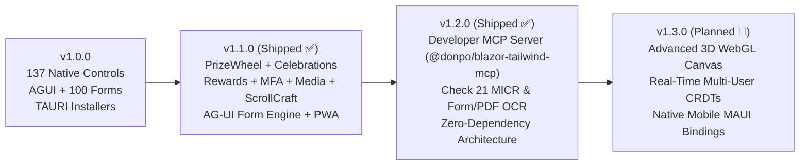

# 🗺️ Blazor Tailwind UI — Official Product Roadmap

This document outlines the strategic architecture, component specifications, and planned delivery milestones for upcoming innovations in **Blazor Tailwind UI**.

---

## 📋 Overview of Roadmap Pillars

| Pillar / Feature | Planned Component(s) | Status | Domain |
|---|---|---|---|
| **1. ScrollCraft Object Animation to Content** | `TwScrollCraft` | Shipped (v1.1.0) ✅ | UI & Micro-Interactions |
| **2. Celebration Animations Editor** | `TwCelebrationEditor` | Shipped (v1.1.0) ✅ | Interactive Creative Tools |
| **3. Celebration Randomizer for Morale Giveaways** | `TwPrizeWheel` | Shipped (v1.1.0) ✅ | Gamification & Morale |
| **4. Rewards Center for Common Offerings** | `TwRewardsCenter` | Shipped (v1.1.0) ✅ | Enterprise HR & Operations |
| **5. Native Media Recorder & Player** | `TwMediaRecorder` | Shipped (v1.1.0) ✅ | Hardware & Media Interop |
| **6. Multi-Factor Auth (MFA) Methods Suite** | `TwMfaAuthSuite`, `TwOtpInput` | Shipped (v1.1.0) ✅ | Security, Auth & Compliance |
| **7. AG-UI Form Engine & HITL Workbenches** | `TwAguiFormCanvas`, `AguiFormSchema` | Shipped (v1.1.0) ✅ | Agentic AI & Generative UI |
| **8. PWA 1-Click App Installer** | `TwPwaInstallButton`, `TwPwaService` | Shipped (v1.1.0) ✅ | Client WebAssembly & Mobile |
| **9. Form / PDF OCR & Check 21 MICR Engine** | `TwMicrCheckReader`, `TwDocumentOcrStudio`, `TwSmartOcrButton` | Shipped (v1.2.0) ✅ | Client WebAssembly & FinTech |
| **10. Developer MCP Server** | `@donpo/blazor-tailwind-mcp` | Shipped (v1.2.0) ✅ | Developer Tooling & Agentic AI |

---

## 1. 📜 ScrollCraft Object Animation to Content

### Objective
Provide smooth, hardware-accelerated scroll-driven animations that anchor UI elements, illustrations, and callout cards to scroll progress without heavy external JS animation bundles (like GSAP or ScrollMagic).

### Key Architectural Specifications
- **`TwScrollCraft`**: Parent wrapper tracking viewport intersection thresholds (`IntersectionObserver` + CSS `animation-timeline: view()` and `animation-timeline: scroll()`).
- **Dynamic Physics Hooks**:
  - `ScrollEffect.Parallax`: Multi-layer depth shifting on background/foreground layers.
  - `ScrollEffect.PinAndScrub`: Pins an illustration or mock device in place while bullet points scrub through.
  - `ScrollEffect.FadeZoomIn`: Element scales from `0.9` to `1.0` with opacity fade as it enters the focal reading zone.
  - `ScrollEffect.PathMorph`: SVG path `d` attribute interpolation linked to scroll position.
- **Pure CSS Fallbacks**: Gracefully falls back to standard CSS transitions for browsers without scroll-timeline support.

```razor
<TwScrollCraft Effect="ScrollEffect.PinAndScrub" ScrubDistance="400" TriggerHook="0.3">
    <PinnedContent>
        <TwFeatureMockup Device="DeviceKind.Laptop" />
    </PinnedContent>
    <ScrollSteps>
        <TwScrollStep Title="Sub-millisecond Sorting" Description="..." />
        <TwScrollStep Title="Dual-Plane Latency Meters" Description="..." />
    </ScrollSteps>
</TwScrollCraft>
```

---

## 2. 🎆 Celebration Animations Editor

### Objective
A visual developer workbench that lets engineers and designers fine-tune confetti bursts, fireworks, and celebration physics live in the browser, with one-click export to copy-pasteable Blazor markup and JSON schemas.

### Key Architectural Specifications
- **`TwCelebrationEditor`**: Split-pane visual studio:
  - **Live Physics Viewport**: HTML5 Canvas running 60fps particle physics simulation.
  - **Parameter Sliders**:
    - Particle Count (`20` to `500`)
    - Velocity / Initial Force (`5` to `50` px/frame)
    - Spread Angle (`15°` to `360°`)
    - Gravity Simulation (`0.1` to `2.0` m/s²)
    - Wind Drift & Drag Coefficient
    - Decay / Fade Lifetime (`1.0s` to `8.0s`)
  - **Custom Particle Shapes**:
    - Traditional rectangular paper confetti
    - Star bursts & Golden coins (Corporate awards)
    - Custom SVG brand shapes & Emojis (`🎉`, `⭐`, `🚀`, `💎`, `🍕`)
  - **Code Exporter**: 1-click generation of `<TwConfetti ParticleCount="..." Spread="..." ... />` or C# `await Confetti.FireAsync(options);`.

---

## 3. 🎲 Celebration Randomizer for Game Prize Giveaways (Team Morale)

### Objective
Turn company parties, sprint retrospective celebrations, and all-hands town halls into engaging team moments with interactive, high-morale prize giveaway games.

### Key Architectural Specifications
- **`TwPrizeRandomizer` / `TwPrizeWheel`**:
  - **Spinning Fortune Wheel**: SVG segment wheel with dynamic wedge weighting, sound-effect cues, acceleration physics, and decelerating tick pointers.
  - **Lucky Card Flip & Match**: Memory card flip reveal with spot prize badges.
  - **Loot Box / Mystery Chest Unlocker**: 3D CSS chest opening animation accompanied by dynamic confetti explosion and winner banner.
- **Customizable Giveaway Pool**:
  - Weighted probabilities (e.g. Common: "Company Tumbler", Rare: "$50 Coffee Card", Legendary: "Extra Friday Off").
  - CSV/JSON roster import: Automatically load employee or attendee rosters to pick fair random winners with "Already Won" exclusion toggles.
  - Sound Effects: Pure Web Audio API synthesized celebratory chime and drumroll without remote MP3 downloads.

---

## 4. 🎁 Rewards Center for Most Common Rewards Offerings

### Objective
An end-to-end enterprise employee perks and recognition redemption catalog that seamlessly pairs with `TwEmployeeAwardForm` and spot bonus disbursements.

### Key Architectural Specifications
- **`TwRewardsCenter`**:
  - **Category Tabs**:
    1. *Gift Cards & Dining* (Coffee shops, delivery apps, online retail, experiences)
    2. *Company Swag & Gear* (Branded hoodies, mechanical keyboards, ergonomic backpacks)
    3. *Workplace Flexibility* (Extra Floating Holiday, Half-Day Friday Pass, Remote Tech Stipend)
    4. *Learning & Conferences* (Book budget, course subscriptions, summit tickets)
    5. *Charitable Giving* (Dollar-for-dollar corporate donation matches)
  - **Points / Budget Wallet Ledger**: Live balance tracker showing available recognition points or allocated reward currency.
  - **Redemption Flow (`TwRedemptionModal`)**:
    - Item selection with instant confirmation, digital voucher generation, and redemption email webhook dispatch.
    - Tiered access and budget guardrails for managers and team leads.

---

## 5. 🎙️ Media Recorder & Player Suite

### Objective
Expand the existing `TwMediaPlayer` with native browser recording capabilities via the W3C MediaStream and MediaRecorder APIs for async standups, video bug reports, and audio podcast recording.

### Key Architectural Specifications
- **`TwMediaRecorder`**:
  - **Capture Modes**:
    - `MediaMode.AudioOnly`: Microphone recording with live SVG frequency bars and waveform visualizer.
    - `MediaMode.VideoCamera`: HD webcam video recording with camera switcher (front/rear/external).
    - `MediaMode.ScreenShare`: In-browser screen capture with optional picture-in-picture webcam bubble.
  - **Runtime Features**:
    - Audio level meters (VUMeter) to prevent clipping.
    - Pause, resume, and instant trim preview.
    - Client-side blob encoding to WebM / MP4 with one-click local download or upload callback (`EventCallback<byte[]>`).
  - **Integrated Player Link**: Captured recording instantly binds into `TwMediaPlayer` for chapter bookmarking and playback speed adjustment.

---

## 6. 🔐 Multi-Factor Authentication (MFA) Methods Suite

### Objective
Provide enterprise security engineers with modern, drop-in multi-factor authentication controls compliant with NIST 800-63B and zero-trust guidelines.

### Key Architectural Specifications
- **`TwMfaAuthSuite`**:
  - **Method 1: TOTP Authenticator Apps (`TwTotpSetup`)**:
    - Vector QR code display for scanning with authenticator apps.
    - Formatted secret key with 1-click clipboard copy.
    - Six-digit verification code input with immediate auto-submit upon entering the 6th digit.
  - **Method 2: SMS / Email OTP (`TwOtpInput`)**:
    - Segmented 6-box PIN input with automatic focus advance, backspace regression, and paste handling.
    - Cooldown countdown timer for resending codes (`Resend code in 45s`).
  - **Method 3: Passkeys & WebAuthn / FIDO2 (`TwPasskeyAuth`)**:
    - Hardware security keys (YubiKey), biometric Touch ID / Face ID, and Windows Hello.
    - Navigator credentials API interop with fallback to TOTP.
  - **Method 4: Emergency Backup Recovery Codes (`TwRecoveryCodes`)**:
    - 8× 10-character alphanumeric single-use recovery codes.
    - Print-friendly layout and text file download.

---

## 7. 🤖 Adaptive Generative UI (AG-UI) Form Engine & HITL Workbenches

### Objective
Eliminate the tedious "Chat Wall" ping-pong by allowing AI agents to synthesize runtime-adaptive, validated forms directly into the conversation or side-drawer, complete with human-in-the-loop (HITL) approval gates, confidence chips, and type-safe tool callbacks.

### Key Architectural Specifications
- **`TwAguiFormCanvas`**: High-performance, reactive form engine executing entirely in client WebAssembly.
  - **Dynamic Field Compilation**: Synthesizes inputs, textareas, sliders, numeric steppers, switches, radio groups, date pickers, and tags on the fly from an `AguiFormSchema`.
  - **Conditional Dependency Evaluation**: Fields dynamically appear or hide based on user selections (`DependsOnField`, `DependsOnValue`) without page reload.
  - **Confidence Badges & Source Hints**: Fields pre-populated by AI display confidence ratings (`✨ 98%`) and hover tooltips showing source citations (*"Extracted from Quote Header Page 1"*).
  - **Two-Way Diff Inspector**: Live JSON drawer tracking user deviations from agent proposals, with 1-click `✨ Reapply AI Defaults`.
  - **Procedural Sound FX & HITL Resolution**: Submitting triggers procedural fanfare (`TwSoundService`), packaging structured parameters into an `AguiFormSubmission` to unblock agent workflows.

```razor
<TwAguiFormCanvas Schema="@schema" 
                  OnSubmit="HandleApproval" 
                  OnCancel="HandleRejection" />
```

---

## 8. 📲 Progressive Web App (PWA) 1-Click App Installer

### Objective
Allow users and enterprise stakeholders to install the entire Blazor WebAssembly demo as a standalone native desktop or mobile application directly from their browser with zero URL bar clutter and offline caching.

### Key Architectural Specifications
- **`manifest.webmanifest`**: Declares standalone display mode, orientation, background color, theme color, and high-resolution icons (SVG, 192px PNG, 512px maskable PNG).
- **`service-worker.js`**: Pre-caches the WebAssembly runtime, Tailwind stylesheets, Web Audio sound synthesizers, and icons for fast offline startup.
- **`TwPwaInstallButton`**: Reactive Blazor button component listening to `beforeinstallprompt` and `appinstalled` events via `TwPwaService`.
- **Cross-Platform Modal**: Explains 1-click install for Chrome/Edge and step-by-step guidance for iOS Safari (*"Share ➔ Add to Home Screen"*).

```razor
<TwPwaInstallButton />
```

---

## 9. 🏦 Form / PDF OCR & Check 21 MICR Detection Engine

### Objective
Provide client-side WebAssembly optical character recognition (OCR) and financial document intelligence for paper checks, bank drafts, invoices, and tax forms with ANSI X9.27 / ISO 1004 E-13B magnetic ink decoding and automated Federal Reserve routing checksum verification.

### Key Architectural Specifications
- **`TwMicrCheckReader`**: Interactive Check 21 Remote Deposit Capture (RDC) visual check canvas:
  - **MICR E-13B Decoding**: Parses Transit (`⑆`), On-Us (`⑈`), Amount (`⑇`), and Dash (`⑉`) magnetic glyphs.
  - **Federal Reserve Mod-10 ABA Checksum**: Real-time algorithm `[3(d1+d4+d7) + 7(d2+d5+d8) + 1(d3+d6+d9)] mod 10 == 0`.
  - **Courtesy vs Legal Amount Verification**: Compares numeric box with written legal words to prevent deposit discrepancies.
- **`TwDocumentOcrStudio`**: Multi-document studio with spatial bounding boxes for Invoices, Paper Checks, and IRS Form W-9.
- **`TwSmartOcrButton`**: Drop-in Smart Component button mapping document entities directly into form inputs.
- **`TwMarkdownEditor` Integration**: Dedicated `📄 OCR / MICR` toolbar drawer inserting Check 21 ledger and invoice Markdown tables at cursor.

```razor
<TwMicrCheckReader OnCheckScanned="HandleCheck" OnInsertMarkdown="HandleInsert" />
<TwDocumentOcrStudio OnMarkdownExtracted="HandleMarkdown" />
<TwSmartOcrButton OnDocumentScanned="HandleDoc" OnCheckScanned="HandleCheck" />
```

---

## 10. 🔌 Developer Model Context Protocol (MCP) Server (`@donpo/blazor-tailwind-mcp`) — Shipped (v1.2.0) ✅

### Objective
Provide an official, zero-friction **Model Context Protocol (MCP)** server for AI-assisted developer environments (Cursor, Claude Desktop, Antigravity, VS Code Copilot, and Windsurf). Enables developer coding assistants to query the 147+ component library, inspect typed parameter schemas, generate validated AG-UI form JSON, validate ANSI X9.27 MICR lines, and lint Razor markup in real time.

### Key Architectural Specifications
- **Packaging & Transports**:
  - Packaged as a zero-dependency CLI runner: `npx @donpo/blazor-tailwind-mcp` or `dotnet run --project BlazorTailwindUI.Mcp`.
  - Supports standard STDIO and SSE (Server-Sent Events) transports for local IDE and containerized agentic workflows.
- **MCP Tools**:
  - `blazortw_search_components`: Queries all 147+ components by natural language intent (e.g. *"I need a check reader with MICR"*, *"show me a financial pivot grid"*), returning full parameter docs and Razor markup.
  - `blazortw_get_component_api`: Returns the typed C# parameters, events (`EventCallback<T>`), and default values for any component.
  - `blazortw_scaffold_form`: Generates production-ready `AguiFormSchema` or `TwFormEngine` JSON schemas and C# models for any enterprise domain.
  - `blazortw_validate_micr`: Evaluates ANSI X9.27 MICR lines and calculates Federal Reserve Mod-10 ABA routing checksums.
  - `blazortw_audit_markup`: Analyzes Razor files for mobile-first touch compliance (44px tap targets), zero third-party commercial UI dependencies, and dark-mode styling synchronization.
- **MCP Resources**:
  - `blazortw://components/catalog`: Real-time machine-readable catalog of all 147+ components.
  - `blazortw://forms/100-standard`: The 100 enterprise form schemas across 10 functional domains.
  - `blazortw://design/tokens`: Tailwind utility classes, design tokens, and animation presets.
- **MCP Prompts**:
  - `scaffold-enterprise-page`: Orchestrates end-to-end scaffolding of a full-stack Blazor WASM page adhering to design system guidelines.
  - `synthesize-agui-agent`: Guides backend LLM agents in outputting type-safe `AguiWidgetSchema` and `AguiFormSchema` JSON trees.

#### Claude Desktop & Cursor Configuration Snippet
```json
{
  "mcpServers": {
    "blazor-tailwind": {
      "command": "npx",
      "args": ["-y", "@donpo/blazor-tailwind-mcp"]
    }
  }
}
```

---

## 📅 Target Milestones



Contributions and discussions are welcomed in the [GitHub Discussions](https://github.com/donpotts/BlazorTailwindUI/discussions) and [Issue Tracker](https://github.com/donpotts/BlazorTailwindUI/issues).
